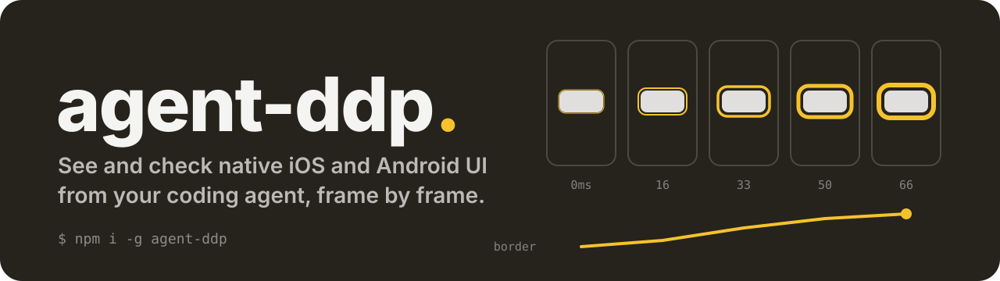
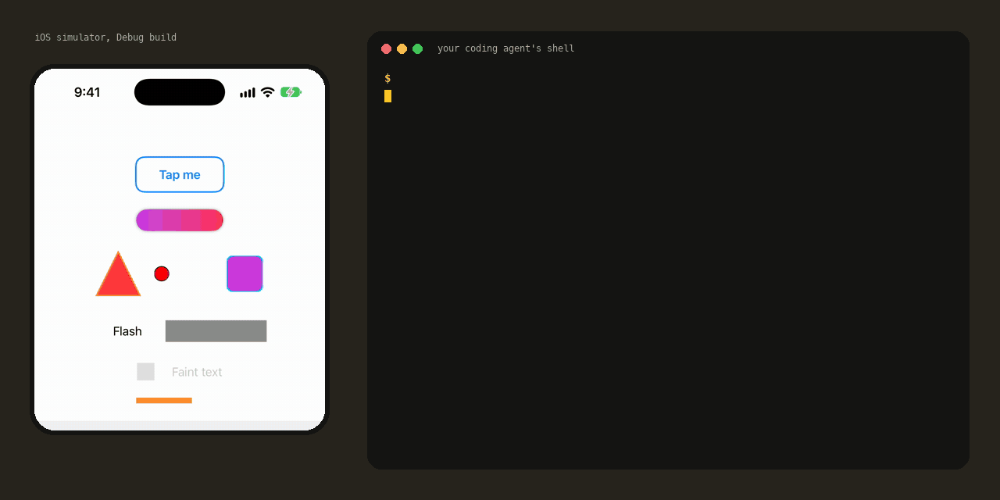

<p align="center">
  
</p>

<p align="center">
  <a href="https://github.com/bandada-labs"></a>
  <a href="https://www.npmjs.com/package/agent-ddp"></a>
  <a href="https://github.com/bandada-labs/agent-ddp/actions/workflows/ci.yml"></a>
  <a href="https://github.com/bandada-labs/agent-ddp/blob/main/LICENSE"></a>
  
</p>

# agent-ddp

Your coding agent can use a native iOS or Android app the way a person does, and tell you what changed after every touch.

`ddp` taps, types, scrolls and goes back on any simulator, emulator or Android phone, with nothing added to the app. Each action answers in one line with what appeared, what went away and what changed, so the agent knows where it is without a screenshot. A task the agent walked once replays later with no model and no tokens, on iOS or on Android. Add a small library to the Debug build and the agent also sees what each element drew, frame by frame, with checks that report a problem only when the platform itself confirms it.

Works with Claude Code, Codex, Cursor and any agent that can run a CLI or connect over MCP. SwiftUI and UIKit on iOS, Compose and Views on Android.

```console
$ ddp up --platform ios --app com.apple.Preferences
up ios BA5429F9-9C73-48CB-A3E4-EF6813BEA834 in 7.7s
com.apple.Preferences did not answer as an app with the library (the app has no control endpoint): tree, tap, type, swipe, press and walk now go through the platform, with no checks; if it has the library, ddp connect BA5429F9-9C73-48CB-A3E4-EF6813BEA834 --app com.apple.Preferences
$ ddp tap General
tap General on BA5429F9-9C73-48CB-A3E4-EF6813BEA834 in 1331ms; new: @e1 "Settings", @e24 "General", @e25 "Manage your overall setup and preferences for iPhone, such as software updates, device language, CarPlay, AirDrop, and more.", @e26 "About", @e27 "AutoFill & Passwords", +5; gone: @e6 "Dictate", @e7 "Settings", @e8 "Accessibility", @e9 "Action Button", @e10 "Appearance", +10; no checks (no SDK)
$ ddp tap About
tap About on BA5429F9-9C73-48CB-A3E4-EF6813BEA834 in 7ms; new: @e33 "About", @e34 "Certificate Trust Settings", @e35 "Name, iPhone", @e36 "Photos, 6", @e37 "Model Number, A3472LL/A", +7; gone: @e24 "General", @e25 "Manage your overall setup and preferences for iPhone, such as software updates, device language, CarPlay, AirDrop, and more.", @e26 "About", @e27 "AutoFill & Passwords", @e28 "Dictionary", +4; changed: @e1 "General"; no checks (no SDK)
$ ddp back
back (edge swipe) on BA5429F9-9C73-48CB-A3E4-EF6813BEA834 in 363ms; new: @e24 "General", @e25 "Manage your overall setup and preferences for iPhone, such as software updates, device language, CarPlay, AirDrop, and more.", @e26 "About", @e27 "AutoFill & Passwords", @e28 "Dictionary", +5; gone: @e33 "About", @e34 "Certificate Trust Settings", @e35 "Name, iPhone", @e36 "Photos, 6", @e37 "Model Number, A3472LL/A", +7; changed: @e1 "Settings"; no checks (no SDK)
```

That is the whole loop, on Settings, an app ddp knows nothing about. One line per action, about 100 tokens, and the refs in it (`@e26`) work in the next command. On Android a tap takes about 35 ms. On iOS a command takes about 200 ms and nothing is installed in the simulator: ddp talks to the simulator's own touch and accessibility services from the Mac, with no XCTest.

## Quick start

```bash
npm i -g agent-ddp
ddp up --platform ios --install MyApp.app --app com.example.myapp
ddp tree
```

`ddp up` makes a simulator or emulator of its own from a warm base (it boots in under 10 s), installs the app, starts it and keeps the session, so later commands need no device id. `ddp down` removes it. You can also point ddp at a device you already have with `--device <udid or serial>`, Android phones included. `ddp doctor` checks the device, the app and the connection, and prints the fix for whatever is missing.

The CLI is one native binary for macOS, Linux and Windows. It needs `xcrun simctl` for iOS and `adb` for Android.

## Walk a task once, replay it for free

The agent walks a task in plain words. ddp keeps every step with what it touched, what changed and a screenshot.

```console
$ ddp launch BA5429F9-9C73-48CB-A3E4-EF6813BEA834 --app dev.agentddp.sample
launched dev.agentddp.sample on ios BA5429F9-9C73-48CB-A3E4-EF6813BEA834
connected to dev.agentddp.sample on ios BA5429F9-9C73-48CB-A3E4-EF6813BEA834 (port 61496): 25 elements, 51 nodes on screen
$ ddp walk start "rename a row"
walk rename-a-row started on ios BA5429F9-9C73-48CB-A3E4-EF6813BEA834; each tap, swipe, type and press is now a step; ddp walk expect <element> adds a check; end with ddp walk end pass|fail
$ ddp tap "Tap me"
tapped Tap me at (201, 146); changed: @e1 animatedButton, @e2 canvasDot, @e3 customPath, @e4 drawingGroupBox, @e5 gradientCapsule
$ ddp long-press "Row with context menu"
long-press Row with context menu (201, 684); changed: @e7 Last action: none; new: @e6 Delete, @e8 Rename, @e9 Row with context menu
$ ddp tap Rename
tapped Rename at (201, 569); changed: @e6 Delete, @e8 Rename; new: @e10 Last action: rename; gone: @e7 Last action: none
$ ddp walk expect "Last action: rename"
expect "Last action: rename": on screen
$ ddp walk end pass
walk rename-a-row: PASS, 4 steps on ios BA5429F9-9C73-48CB-A3E4-EF6813BEA834
task: rename a row
1. tapped Tap me at (201, 146); changed: @e1 animatedButton, @e2 canvasDot, @e3 customPath, @e4 drawingGroupBox, @e5 gradientCapsule
2. long-press Row with context menu (201, 684); changed: @e7 Last action: none; new: @e6 Delete, @e8 Rename, @e9 Row with context menu
3. tapped Rename at (201, 569); changed: @e6 Delete, @e8 Rename; new: @e10 Last action: rename; gone: @e7 Last action: none
4. expect "Last action: rename": on screen
file: .ddp/sessions/sample/walks/rename-a-row.jsonl; screenshots: .ddp/sessions/sample/walks/rename-a-row
next: ddp walk replay rename-a-row (no model, on any device)
$ ddp stop && ddp launch BA5429F9-9C73-48CB-A3E4-EF6813BEA834 --app dev.agentddp.sample
stopped dev.agentddp.sample on ios BA5429F9-9C73-48CB-A3E4-EF6813BEA834
launched dev.agentddp.sample on ios BA5429F9-9C73-48CB-A3E4-EF6813BEA834
connected to dev.agentddp.sample on ios BA5429F9-9C73-48CB-A3E4-EF6813BEA834 (port 62828): 25 elements, 51 nodes on screen
$ ddp walk replay rename-a-row
replay rename-a-row on ios BA5429F9-9C73-48CB-A3E4-EF6813BEA834: 4 steps passed in 6.5s
$ ddp walk replay rename-a-row --device emulator-5560
replay rename-a-row on android emulator-5560: 4 steps passed in 8.8s
$ ddp walk parity rename-a-row
parity rename-a-row: ios passed, android passed; 0 steps differ
```

A replay starts from the screen as it is, so the app is started again first. It finds each target again by its id or label, never by old pixels, and fails only when a target or an expected element is not there. The same walk replays on the other platform, and `walk parity` lists what one platform showed and the other did not.

ddp calls no model. The agent you already run walks the task; ddp records it and replays it.

## See what was drawn

With the library in the Debug build, the agent also gets the screen as elements, each with what it drew. Refs like `@e1` work in the next command.

```
$ ddp tree
t=5050ms (frame 299 of 300), unit pt
@e1 animatedButton "Selected" [134, 122, 134.33, 48.33]
  z=1 layer fill #0088FFFF corner 12 [134, 122, 134.33, 48.33]
  z=2 bitmap [166, 136, 70.33, 20.33]
  z=3 layer border 6 #FF8D28FF corner 15 [131, 119, 140.33, 54.33]
@e2 gradientCapsule [91, 194.33, 220, 30]
  z=4 layer corner 15 [91, 194.33, 220, 30]
  z=5 gradient corner 15 [91, 194.33, 220, 30]
```

An animation as tracks per element, with sparklines, so the agent checks timing and easing without a video:

```
$ ddp read --for 5s --then "ddp tap animatedButton"
ios 300 frames over 5050 ms, unit pt
animatedButton: frame [134, 122, 134.33, 48.33] fill #0088FFFF border 6 kinds bitmap,layer
  fill: #FFFFFFFF -> #0088FFFF, 112 values, changing 700..2583.33ms
  border: 2 -> 6 ▁▁▂▅▇███████, changing 666.67..2566.67ms, min 2 @0ms, max 6 @2566.67ms
  opacity: 1 -> 1 █▁▇█████████, changing 521.81..1050ms, min 0.2 @521.81ms  TRANSIENT (same at start and end, different in between)
  label: Tap me -> Selected, 2 values, changing 598.82..598.82ms
```

Checks that exit 1 on a problem, so the same command works as a gate in CI:

```
$ ddp check all
COVERED coveredLabel: the screen shows #8E8E93FF where its text has ink and around it, so the text cannot be seen in [199, 352.33, 104.33, 20.33]
SMALL TARGET smallTarget: a touch reaches it over 34x43, under 44x44
LOW CONTRAST faintText: 1.6:1, #CCCCCCFF on #FFFFFFFF, needs 3:1 at least (its size is estimated)
check all over 61 frames: overlap 1, a11y 2 (ran overlap, corners, jank, settle, a11y)
```

A check reports a problem only when the platform says so: its hit test, the pixels of the app's own windows, its frame times. What it cannot tell, it does not report.

<p align="center">
  
</p>

### Give this to your agent

Paste this in your agent's chat inside your app's repo. It learns the commands by itself.

```
Set up agent-ddp so you can use and check this app's UI: https://github.com/bandada-labs/agent-ddp

1. Install the CLI: npm i -g agent-ddp
2. Run `ddp skills get core` and follow it. Start with `ddp doctor`. With nothing in the app you can
   already drive it on a simulator, an emulator or an Android phone.
3. To see what each element drew and run the checks, add the library to the Debug build only:
   - iOS: add the Swift package https://github.com/bandada-labs/agent-ddp (from 0.5.0) and call
     AgentDDP.start() at launch. It does nothing in Release. Simulator only for now. Xcode 16.4 or later.
     Without Xcode or SwiftPM: ios/build-swiftc.sh builds a static library and module for plain swiftc.
   - Android: add maven("https://jitpack.io") to the repositories and
     debugImplementation("com.github.bandada-labs:agent-ddp:v0.5.0"). It starts by itself.
```

`samples/ios` and `samples/android` are small apps with the library already wired in.

## What it does today

Without the library, on any build:

- Taps, double taps, long presses, swipes, drags, typing (ñ, é and emoji too), keys, scrolling until an element shows, and back. A touch on an element that is covered or off screen is refused with the reason, instead of landing on something else.
- The screen as the platform's accessibility tree, with refs and state (checked, selected, focused, an error the app set). A menu, dialog or sheet over the app is said to be open.
- Screenshots of the whole screen or of one element, permissions, the app's lifecycle (`stop`, `clear`, `logs`) and, on Android, the app's own instrumentation tests.
- Walks with replay and iOS against Android parity, as above.

With the library, in Debug builds:

- Reads the screen per element: frame, fill, border, corner radius, opacity, clipping, text style and what covers it.
- Records takes frame by frame as JSON lines, and summarizes each element's tracks as sparklines and easing curves.
- Checks: covered text, corners past their radius, jank, animations that never settle, accessibility (touch targets, labels, contrast), an expected timeline, iOS vs Android parity and a saved baseline.
- Keeps the last 15 minutes inside the app: every change, tap and screen. `ddp history` shows them, `ddp history at <time>` turns one moment into a take to check.
- Performance, memory, crashes, the line of code that made an element, Compose recompositions, the app's storage and network, and its clock: pause it, step it, slow it down.

Output is made for agents: element refs (`@e3`), small trees, a size cap, batches and an MCP server.

## What to ask your agent

Once it is set up, prompts like these work:

- "Sign up as a new user on the iOS simulator with ddp walk, then replay the walk on Android and tell me what is different."
- "Build the onboarding screen and check it on the iOS simulator and the Android emulator. Fix anything `ddp check all` finds."
- "The like button animation feels slow. Measure it and make it match the spec: 250 ms, ease out."
- "Something flickered on the home screen a few minutes ago. Find it in `ddp history`."
- "Check this screen with the largest text size and in dark mode."

## MCP

`ddp mcp` runs the same commands as MCP tools on stdio:

```json
{
  "mcpServers": {
    "ddp": {
      "command": "ddp",
      "args": ["mcp", "--tools", "all"]
    }
  }
}
```

`--tools` takes `core`, `live`, `checks` or `all`. The plain CLI is usually cheaper in tokens, so prefer it when the agent can run commands.

## How it works

Without the library, ddp works through the platform. On Android it carries a small instrumentation inside its own binary, installs it on the device the first time and sends touches as the system's own input. On iOS it sends touches and keys into the simulator's HID service and reads its accessibility service, the elements VoiceOver reads, both from the Mac. Each action reads the screen before and after and prints the difference once the screen settles.

With the library, the app itself is the server. The library reads the platform's own view and layer trees on every frame and serves them on a local endpoint. On iOS the CLI finds the port in the app's simulator container; on Android it reaches the app through `adb forward`.

There is no daemon. Every `ddp` command is a short call. A recording or a walk is a plain JSON lines file, so reads and checks also work offline on a saved take.

## Why native

A lot of teams choose React Native, Flutter or another layer on top of the platform because one codebase is cheaper, and because tooling for agents has been much better on the web. DDP tries to close the second gap. An agent can now use and check a SwiftUI or Compose screen in the same way it checks a web page, with the platform's own layers and nothing in between.

So if the extra layer is there mostly for the tooling, it may not be needed anymore. Native apps get the platform's own animations, accessibility and performance, and with DDP the agent can still review them.

## FAQ

### How is it different from XCUITest, Espresso, Maestro or agent-device?

Without the library ddp also drives the app through the accessibility tree, with two differences: every action says what changed, and a walk is kept and replayed without writing a test or calling a model. With the library ddp reads what was drawn: colors, borders, corners, opacity, what covers what, and how each value moved over the frames. Those tools work well next to it.

### Does it call a model?

No. The agent you already use is the model. ddp records, replays and checks without tokens.

### Does it ship in my release build?

No. Nothing is added to the app to drive it. The library is Debug only: on iOS `AgentDDP.start()` does nothing outside Debug, and on Android it is a `debugImplementation` dependency.

### Does it work on a physical device?

iOS works on the simulator only for now. Android goes through `adb`, so it reaches emulators and the phones `adb devices` lists. A MIUI phone asks you to tap Install once per ddp version.

## Docs

- `ddp skills get core`: the guide for agents, shipped with the CLI so it always matches the version ([docs/skills](docs/skills)). [skills/ddp/SKILL.md](skills/ddp/SKILL.md) is a thin skill file that points there.
- [docs/agents.md](docs/agents.md): every command, its output and the recording format.
- [docs/protocol.md](docs/protocol.md): the wire protocol between the library and a client.
- [ARCHITECTURE.md](ARCHITECTURE.md): how the parts fit and the rules every change keeps.
- [docs/README.md](docs/README.md): status, decisions and ADRs.
- [SURVEY.md](SURVEY.md): what existing tools could and could not see before DDP.

Without npm: `cargo install --git https://github.com/bandada-labs/agent-ddp agent-ddp`.

## Limits

iOS works on the simulator, not on devices yet. Without the library nothing is checked (each line ends `no checks (no SDK)`), keys follow a US keyboard layout, iOS assumes portrait, and the iOS tree leaves out what the keyboard covers, as VoiceOver does. The library works in Debug builds only. Not seen yet: text and images inside a SwiftUI `Canvas` (its shapes are read), and system UI outside the app such as iOS alerts.

## Contributing

Issues and pull requests are welcome. See [CONTRIBUTING.md](CONTRIBUTING.md), and [SECURITY.md](SECURITY.md) for anything security related. Changes are listed in [CHANGELOG.md](CHANGELOG.md).

## License

MIT, see [LICENSE](LICENSE).
