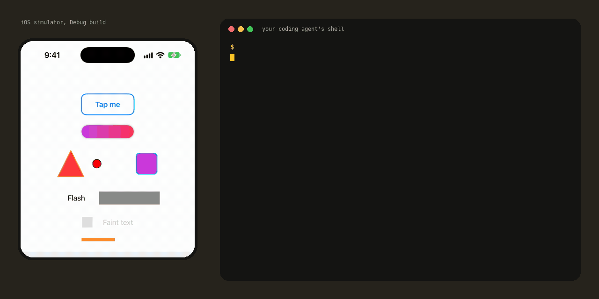
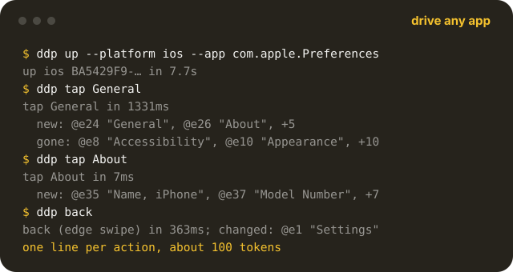
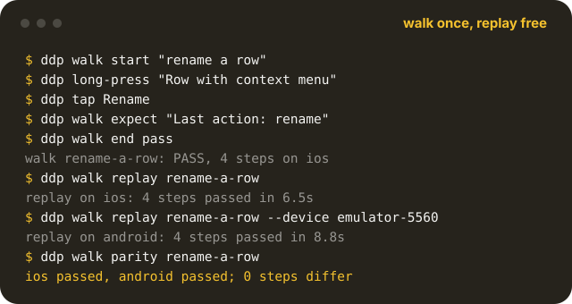
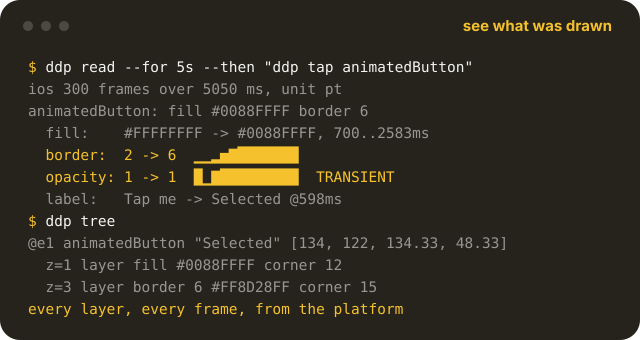
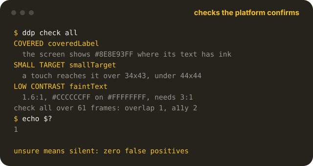

<p align="center">
  
</p>

<p align="center">
  <strong>Your coding agent uses a native iOS or Android app like a person, and is told what changed after every touch.</strong>
</p>

<p align="center">
  <a href="#give-this-to-your-agent">Give it to your agent</a> •
  <a href="#quick-start">Quick start</a> •
  <a href="#what-it-does">What it does</a> •
  <a href="#mcp">MCP</a> •
  <a href="#faq">FAQ</a> •
  <a href="docs/agents.md">Docs</a>
</p>

<p align="center">
  <a href="https://github.com/bandada-labs"></a>
  <a href="https://www.npmjs.com/package/agent-ddp"></a>
  <a href="LICENSE"></a>
  
  <a href="https://github.com/bandada-labs/agent-ddp/actions/workflows/ci.yml"></a>
</p>

<p align="center">
  
  <br>
  <em>One tap recorded frame by frame, then <code>ddp check all</code> on the result.</em>
</p>

<a id="give-this-to-your-agent"></a>
## Give this to your agent

Paste it in your agent's chat, inside your app's repo. It learns the rest by itself.

```
Set up agent-ddp so you can use and check this app's UI: https://github.com/bandada-labs/agent-ddp

1. Install the CLI: npm i -g agent-ddp
2. Run `ddp skills get core` and follow it. Start with `ddp doctor`. With nothing in the app you can
   already drive it on a simulator, an emulator or an Android phone.
3. To see what each element drew and run the checks, add the library to the Debug build only:
   - iOS: add the Swift package https://github.com/bandada-labs/agent-ddp (from 0.6.0) and call
     AgentDDP.start() at launch. It does nothing in Release. Simulator only for now. Xcode 16.4 or later.
     Without Xcode or SwiftPM: ios/build-swiftc.sh builds a static library and module for plain swiftc.
   - Android: add maven("https://jitpack.io") to the repositories and
     debugImplementation("com.github.bandada-labs:agent-ddp:v0.6.0"). It starts by itself.
```

Works with Claude Code, Codex, Cursor and any agent that runs a CLI or speaks MCP.

<a id="what-it-does"></a>
## What it does

<table width="100%">
  <tr>
    <td width="50%" align="center">
      <b>Drive any app</b><br>
      <sub>Tap, type, swipe, back. Each action answers in one line: what appeared, what went away. Nothing added to the app.</sub><br><br>
      
    </td>
    <td width="50%" align="center">
      <b>Walk once, replay for free</b><br>
      <sub>The agent walks a task one time. ddp replays it with no model, on iOS and on Android.</sub><br><br>
      
    </td>
  </tr>
  <tr>
    <td width="50%" align="center">
      <b>See what was drawn</b><br>
      <sub>With the Debug library: every layer of every frame, and each animation as tracks with sparklines.</sub><br><br>
      
    </td>
    <td width="50%" align="center">
      <b>Checks the platform confirms</b><br>
      <sub>Covered text, small targets, contrast, jank. Exit 1 on a problem, so it works as a CI gate.</sub><br><br>
      
    </td>
  </tr>
</table>

| | Without the library | With the library (Debug only) |
|---|---|---|
| Drive: tap, type, swipe, scroll, back | ✓ | ✓ |
| Screen as the accessibility tree, with refs | ✓ | ✓ |
| Walk, replay, iOS vs Android parity | ✓ | ✓ |
| Fill, border, corners, opacity, what covers what | | ✓ |
| Frame-by-frame recording, sparklines, easing | | ✓ |
| Checks: covered, corners, jank, settle, a11y, baseline | | ✓ |
| Last 15 minutes kept in the app (`ddp history`) | | ✓ |

SwiftUI and UIKit on iOS, Compose and Views on Android. On Android a tap takes about 35 ms, on iOS a command about 200 ms.

<a id="quick-start"></a>
## Quick start

```bash
npm i -g agent-ddp
ddp up --platform ios --install MyApp.app --app com.example.myapp   # or --platform android
ddp tree
```

`ddp up` makes its own simulator or emulator (boots in under 10 s), installs and starts the app. `ddp down` removes it. `--device <udid or serial>` uses one you already have, Android phones included. `ddp doctor` prints the fix for whatever is missing.

One native binary for macOS, Linux and Windows. Needs `xcrun simctl` for iOS and `adb` for Android. Without npm: `cargo install --git https://github.com/bandada-labs/agent-ddp agent-ddp`.

## What to ask your agent

- "Sign up as a new user on the iOS simulator with ddp walk, then replay it on Android and tell me what is different."
- "Build the onboarding screen and check it on both platforms. Fix anything `ddp check all` finds."
- "The like button animation feels slow. Make it 250 ms, ease out."
- "Something flickered on the home screen a few minutes ago. Find it in `ddp history`."

<a id="mcp"></a>
<details>
<summary><b>MCP setup</b></summary>

<br>

`ddp mcp` runs the same commands as MCP tools on stdio. `--tools` takes `core`, `live`, `checks` or `all`.

```json
{
  "mcpServers": {
    "ddp": { "command": "ddp", "args": ["mcp", "--tools", "all"] }
  }
}
```

The plain CLI is usually cheaper in tokens, so prefer it when the agent can run commands.

</details>

<details>
<summary><b>How it works</b></summary>

<br>

Without the library, ddp works through the platform. On Android it installs a small instrumentation from its own binary and sends touches as the system's input. On iOS it talks to the simulator's HID and accessibility services from the Mac, with no XCTest. Each action reads the screen before and after and prints the difference.

With the library, the app is the server: it reads the platform's own view and layer trees on every frame and serves them on a local endpoint. There is no daemon. A recording or a walk is a plain JSON lines file, so reads and checks also work offline.

A check reports a problem only when the platform confirms it: its hit test, the pixels of the app's own windows, its frame times. What it cannot tell, it does not report.

</details>

<a id="faq"></a>
<details>
<summary><b>FAQ</b></summary>

<br>

**How is it different from XCUITest, Espresso, Maestro or agent-device?** Every action says what changed, and a walk replays without writing a test or calling a model. With the library ddp also reads what was drawn and how each value moved over the frames. Those tools work well next to it.

**Does it call a model?** No. The agent you already use is the model.

**Does it ship in my release build?** No. Driving adds nothing to the app. The library is Debug only: `AgentDDP.start()` does nothing outside Debug on iOS, and it is a `debugImplementation` on Android.

**Physical devices?** iOS: simulator only for now. Android: anything `adb devices` lists. A MIUI phone asks you to tap Install once per ddp version.

**Why native?** Teams often pick React Native or Flutter partly because agent tooling was better on the web. ddp closes that gap for SwiftUI and Compose.

</details>

<details>
<summary><b>Limits</b></summary>

<br>

iOS works on the simulator, not on devices yet. Without the library nothing is checked (each line ends `no checks (no SDK)`), keys follow a US layout, iOS assumes portrait, and the iOS tree leaves out what the keyboard covers, as VoiceOver does. Not seen yet: text and images inside a SwiftUI `Canvas`, and system UI such as iOS alerts.

</details>

## Docs

| | |
|---|---|
| `ddp skills get core` | The guide for agents, shipped with the CLI ([docs/skills](docs/skills), [SKILL.md](skills/ddp/SKILL.md)) |
| [docs/agents.md](docs/agents.md) | Every command, its output and the recording format |
| [docs/protocol.md](docs/protocol.md) | The wire protocol between the library and a client |
| [ARCHITECTURE.md](ARCHITECTURE.md) | How the parts fit and the rules every change keeps |
| [docs/README.md](docs/README.md) | Status, decisions and ADRs |
| [SURVEY.md](SURVEY.md) | What other tools could and could not see |

`samples/ios` and `samples/android` are small apps with the library wired in.

## Contributing

Issues and pull requests are welcome: [CONTRIBUTING.md](CONTRIBUTING.md), [SECURITY.md](SECURITY.md), [CHANGELOG.md](CHANGELOG.md).

## License

MIT, see [LICENSE](LICENSE).
