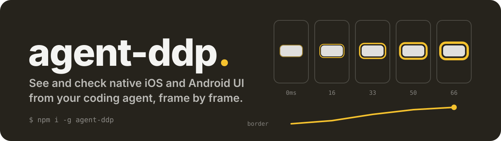
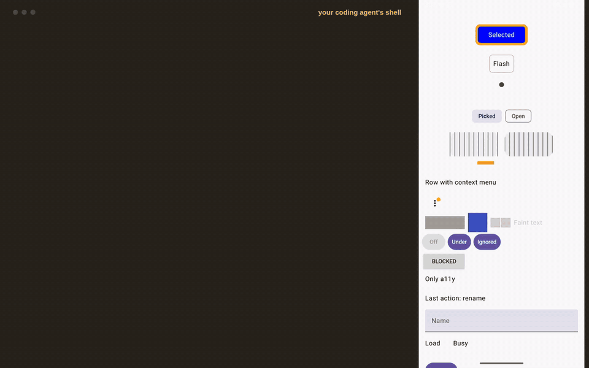
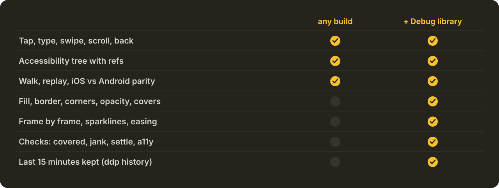
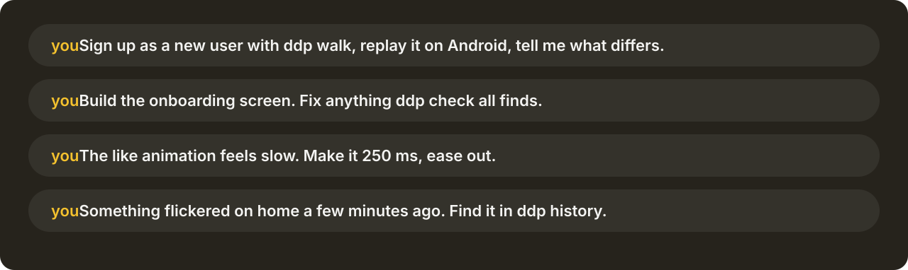

<p align="center">
  
</p>

<p align="center">
  <strong>Your coding agent uses a native iOS or Android app like a person, and is told what changed after every touch.</strong>
</p>

<p align="center">
  <a href="https://github.com/bandada-labs"></a>
  <a href="https://www.npmjs.com/package/agent-ddp"></a>
  <a href="https://github.com/bandada-labs/agent-ddp/blob/main/LICENSE"></a>
  
  <a href="https://github.com/bandada-labs/agent-ddp/actions/workflows/ci.yml"></a>
</p>

<p align="center">
  
  <br>
  <em>Real recording, Android emulator: walk a task once, replay it with no model.</em>
</p>

## Give this to your agent

Paste it in your agent's chat, inside your app's repo. It learns the rest by itself.

```
Set up agent-ddp so you can use and check this app's UI: https://github.com/bandada-labs/agent-ddp

1. Install the CLI: npm i -g agent-ddp
2. Run `ddp skills get core` and follow it. Start with `ddp doctor`. With nothing in the app you can
   already drive it on a simulator, an emulator or an Android phone.
3. To see what each element drew and run the checks, add the library to the Debug build only:
   - iOS: add the Swift package https://github.com/bandada-labs/agent-ddp (from 0.6.1) and call
     AgentDDP.start() at launch. It does nothing in Release. Simulator only for now. Xcode 16.4 or later.
     Without Xcode or SwiftPM: ios/build-swiftc.sh builds a static library and module for plain swiftc.
   - Android: add maven("https://jitpack.io") to the repositories and
     debugImplementation("com.github.bandada-labs:agent-ddp:v0.6.1"). It starts by itself.
```

## What it does

<table width="100%">
  <tr>
    <td width="50%"></td>
    <td width="50%"></td>
  </tr>
  <tr>
    <td width="50%"></td>
    <td width="50%"></td>
  </tr>
</table>

<p align="center">
  
  <br>
  <em>With the Debug library, iOS simulator: one tap recorded frame by frame, then <code>ddp check all</code>.</em>
</p>

<p align="center">
  
</p>

## Quick start

```bash
npm i -g agent-ddp
ddp up --platform android --install app-debug.apk --app com.example.myapp
# iOS: ddp up --platform ios --install MyApp.app --app com.example.myapp
ddp tree
```

## Then ask

<p align="center">
  
</p>

## More

[FAQ, MCP and limits](https://github.com/bandada-labs/agent-ddp/blob/main/docs/faq.md) • [Every command](https://github.com/bandada-labs/agent-ddp/blob/main/docs/agents.md) • [Protocol](https://github.com/bandada-labs/agent-ddp/blob/main/docs/protocol.md) • [Architecture](https://github.com/bandada-labs/agent-ddp/blob/main/ARCHITECTURE.md) • [Status and decisions](https://github.com/bandada-labs/agent-ddp/blob/main/docs/README.md) • [Changelog](https://github.com/bandada-labs/agent-ddp/blob/main/CHANGELOG.md) • [Contributing](https://github.com/bandada-labs/agent-ddp/blob/main/CONTRIBUTING.md)

MIT licensed. Works with Claude Code, Codex, Cursor and any agent that runs a CLI or speaks MCP.
